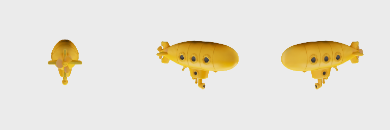
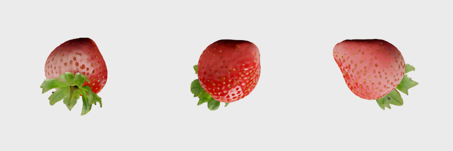

# IDOL native qualification, October 30, 2026

Native Swift/MLX IDOL completed an opaque-image run with automatic BiRefNet
background removal, both image encoders, 50 guided Euler steps, octree anchor
sampling, and 262,144 Gaussian splats. The generated binary PLY contains finite
positions, SH colour, opacity logits, log scales, and y-up quaternions. Camera,
prepared input, and hashed run provenance are exported beside it.

This report qualifies the tested local checkpoint and settings. It does not
establish reconstruction quality for every object, maximum-count memory use,
or equivalence between MLX and PyTorch random streams.

## Checkpoint identity

| Component | Publisher revision | Weight SHA-256 |
| --- | --- | --- |
| IDOL denoiser | `2731c2291fc65a797c5cb627a5e5526fc1490902` | `ded2cacf671bf3978ebc62729087abdbd318ef4752e6805b4c9fc8ffa51fe716` |
| IDOL octree decoder | Same IDOL revision | `9da4d7676bfcadb1c3fdfbff796e6257dadf82d26ec05be7717c79b2b13a1c4e` |
| IDOL Gaussian decoder | Same IDOL revision | `3087eb8ee5763206a53e4078acf2a1bf382dab5147d407ec13a2cf39c04cc544` |
| BiRefNet | Same IDOL revision | `44bbc97b041f879975d0d6d538b8e66a25eb04d1f49aab40697544cdd97eaa8e` |
| DINOv3 ViT-H+/16 | `c807c9eeea853df70aec4069e6f56b28ddc82acc` | `3e1d4d18b9bfa9f28fad8e9de6a783f1313532d3460efa4cd0b12521d81d1a4d` |
| FLUX.2 VAE | `26afe3a78bb242c0a8bb181dcc8937bb16e5c66c` | `d64f3a68e1cc4f9f4e29b6e0da38a0204fe9a49f2d4053f0ec1fa1ca02f9c4b5` |

The installed FLUX.2 VAE hash matches the publisher's metadata. The runtime
uses the original FP32 IDOL weights, FP16 BiRefNet, BF16 image encoders, and
FP32 embeddings and output heads around IDOL's FP16 transformer projections.
No checkpoint weights are committed to this repository.

Reference source: [speridlabs/idol-sdk](https://github.com/speridlabs/idol-sdk)
at `4702a7f00850e34b6e83a2170cc123c3e9570744`. The oracle uses PyTorch 2.15.0,
torchvision 0.29.2, transformers 5.22.1, diffusers 0.42.1, and Pillow 13.0.0.
The full upstream flow uses MPS with the SDK's equivalent real-valued RePo
rotation path. Its BiRefNet uses the higher-precision FP32 CPU path because
torchvision does not implement MPS deformable convolution.

## Opaque submarine reconstruction

Input: `demo/examples/toy-submarine.webp` from the pinned SDK, RGB 768×768.
Both implementations use synthetic framing, seed 42, 50 steps, guidance 3,
time shift 3, and 262,144 splats. MLX and PyTorch draw different posterior,
flow, and anchor samples; their complete runs are compared visually rather
than treated as identical random experiments.

The prepared RGB images differ by 0.249 byte levels on average, with a maximum
difference of four. Native output bounds are approximately
`[-0.170, -0.265, -0.498]` to `[0.146, 0.265, 0.498]` model units in the exported
coordinate frame. Three orbit views preserve the hull, portholes, propeller,
and lower appendage on the unseen side.

Upstream reconstruction:



Native reconstruction:


## Real-mode and minimum-count reconstruction

A second opaque RGB example, `demo/examples/food-strawberry.webp`, completes
50 steps with `--mode real --num-gaussians 32768`. BiRefNet isolates the
foreground, real-mode cropping leaves the expected margin, and the exported
splat count is exactly 32,768. The body, seed pattern, and leaf structure are
visible across the orbit views.



On an Apple M5 Max with 128 GiB unified memory, macOS 27.2, and Swift 6.4.2,
this debug CLI run took 129.84 seconds including checkpoint hashing, background
removal, inference, and export. `/usr/bin/time -l` measured 9.66 GiB maximum
resident size and 19.80 GiB peak process footprint, with zero swaps. This is
an observed run, not a controlled throughput or GPU-memory benchmark.

## Numerical comparisons

The released FP16 native BiRefNet mask compared with the SDK's FP32 CPU
reference has RMSE **0.00011324** and foreground IoU **99.9952%**. Acceptance
requires RMSE ≤0.005 and IoU ≥99% on this image.

Fixed upstream conditioning, noise, latent, and anchors isolate each component
from random-stream differences. Relative RMSE is RMSE divided by reference RMS.
The two encoders consume the same prepared image; VAE posterior noise is
injected from the oracle trace.

| Component | Relative RMSE | Acceptance limit |
| --- | ---: | ---: |
| DINOv3 tokens | 1.101% | 2.5% |
| FLUX.2 VAE tokens | 2.234% | 4% |
| Conditional latent velocity | 0.0828% | 1% |
| Conditional camera velocity | 0.0530% | 1% |
| Unconditional latent velocity | 0.0665% | 1% |
| Final latent after 50 guided steps | 0.5792% | 3% |
| Final camera after 50 guided steps | 0.2372% | 3% |
| Octree logits, resolution 2 | 0.1923% | 1% |
| Octree logits, resolution 16 | 0.2176% | 1% |
| Octree logits, resolution 256 | 0.4554% | 1% |
| Gaussian decoder features | 0.2213% | 1% |

With identical oracle latent and anchors, native Gaussian decoding renders at
80.48–84.31 dB PSNR against upstream across the three orbit views. Foreground
IoU is at least 99.9879%. The deterministic CPU inspection renderer projects
anisotropic covariance, depth-sorts splats, and composites degree-0 SH colour
with the same pixel filter for both inputs. These measurements test decoder
agreement; they are not a score against ground-truth multi-view photographs.

## Reproduction

Download the pinned IDOL and DINOv3 checkpoints after accepting the publishers'
access terms, and place a verified FLUX.2 VAE at `ROOT/vae`. Keep assets and
raw traces outside version control. The local qualification directory used by
this run is `.build/qualification/idol`.

```bash
python scripts/reference-parity/qualify_idol_reference.py \
  --source /path/to/idol-sdk --checkpoint ROOT/checkpoint \
  --dino ROOT/dinov3 --flux /path/to/FLUX.2-dev \
  --image /path/to/idol-sdk/demo/examples/toy-submarine.webp \
  --output ROOT/reference-submarine

python scripts/reference-parity/qualify_idol_reference.py \
  --source /path/to/idol-sdk --checkpoint ROOT/checkpoint \
  --dino ROOT/dinov3 --flux /path/to/FLUX.2-dev \
  --image /path/to/idol-sdk/demo/examples/toy-submarine.webp \
  --output ROOT/reference-submarine --decoder-only

python scripts/reference-parity/qualify_idol_reference.py \
  --source /path/to/idol-sdk --checkpoint ROOT/checkpoint \
  --dino ROOT/dinov3 --flux /path/to/FLUX.2-dev \
  --image /path/to/idol-sdk/demo/examples/toy-submarine.webp \
  --output ROOT/reference-background --background-only

MERERUN_TEST_IDOL_ROOT=ROOT MERERUN_TEST_MLX_DEVICE=gpu MLX_ENABLE_TF32=0 \
  swift test --filter IdolQualificationTests

mere.run vision image-to-3d-idol /path/to/object.png \
  --model ROOT/checkpoint --dino ROOT/dinov3 --vae ROOT/vae \
  --output /path/to/new-output --steps 50 --num-gaussians 262144 --seed 42
```

The committed miniature fixtures additionally cover shifted and padded Swin
windows, both multiscale branches, deformable 1×1/3×3/7×7 kernels, fractional
and out-of-bounds offsets, image patch order, both decoders, and byte-exact
Pillow RGB/RGBA resizing and framing.

## Validation outcome

- All 17 IDOL fixture, preprocessing, and CLI tests pass in the local gate.
- Both opt-in GPU tests pass with the released checkpoint: BiRefNet mask
  comparison and the image encoders, guided flow, three octree levels, and
  Gaussian decoder comparisons.
- Both opaque-image CLI runs complete and their artifact hashes verify. The
  opaque-image dry run returns `planned` without publishing output files.
- Lint, readiness, documentation checks, package policy on all three variants,
  build, CLI help, and hygiene scans pass.
- `./scripts/check.sh` passes in full after the Studio font lookup was changed
  to use Foundation bundle resource resolution. Regression tests cover flat
  SwiftPM bundles, macOS `Contents/Resources` bundles, missing bundles, and
  registration of the bundled Caveat font.

The maximum 1,048,576-splat configuration and other hardware remain outside
this qualification. Renderer agreement measures implementation parity, not
reconstruction accuracy against captured multi-view ground truth.
